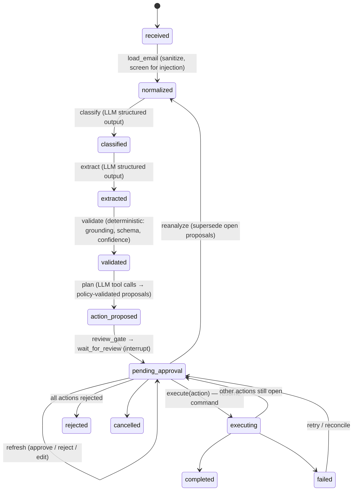
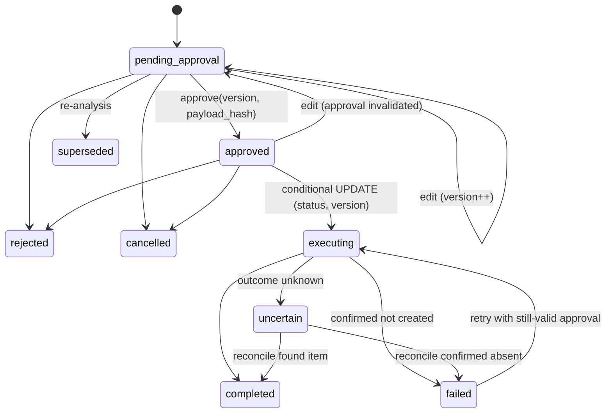
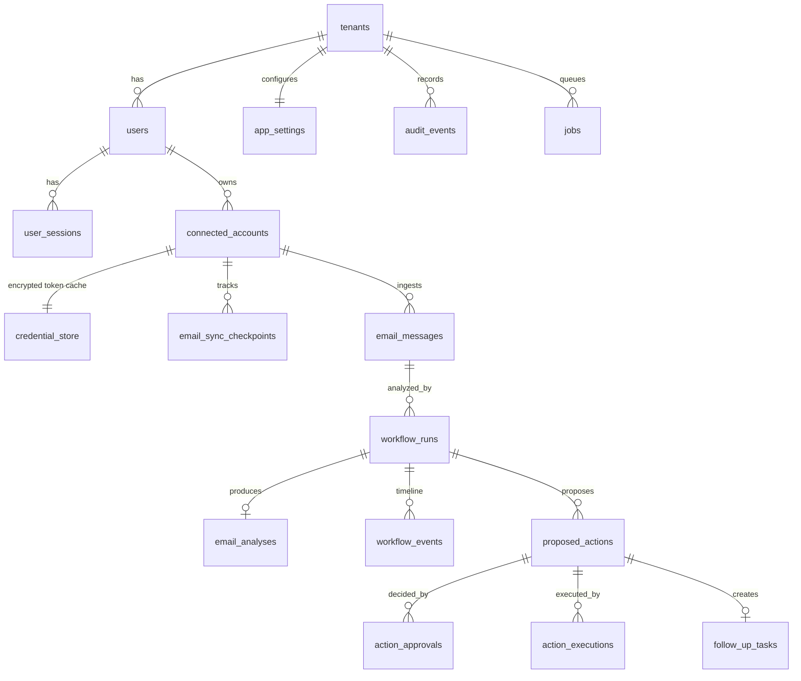

# NUVEXA-AutoTask-AI-Agent — Architecture

NUVEXA turns incoming email into **reviewed, approved, auditable** work: it reads authorized
Outlook mail through Microsoft Graph, classifies and extracts structured data with an LLM,
proposes actions (Azure DevOps work items, reply drafts, internal follow-up tasks, no-action),
waits for a human to approve the exact payload, and only then executes through a deterministic
integration adapter.

## 1. Guiding principles

1. **The LLM proposes; deterministic code disposes.** Validation, permissions, business rules,
   approvals, API execution and retries are plain Python. The model never chooses URLs, HTTP
   methods, headers, credentials, organizations or projects, and never grants approval.
2. **Approval is bound to a payload.** An approval references `(action_id, version, payload_hash)`.
   Any edit bumps the version and invalidates the approval.
3. **PostgreSQL is the system of record.** Workflow checkpoints, job queue, audit log and business
   data all live in Postgres. No other infrastructure is required.
4. **Modular monolith.** One Python codebase, two process types (API, worker), clear module
   boundaries that could later be split.
5. **Demo mode is first class.** Synthetic mailbox, heuristic analysis agent and mock Azure DevOps
   let the full workflow run without any external credential.

## 2. System context

```mermaid
flowchart LR
    user([Reviewer / Approver]) -->|HTTPS, session cookie| web[React dashboard<br/>frontend/]
    web -->|/api/v1 JSON| api[FastAPI API<br/>app.main]
    api --> pg[(PostgreSQL<br/>business data, jobs,<br/>LangGraph checkpoints, audit)]
    worker[Worker process<br/>app.workers.main] --> pg
    worker -->|Graph REST: delta query| graph[Microsoft Graph<br/>Outlook mail]
    worker -->|REST 7.1: create work item| ado[Azure DevOps]
    worker -->|structured output + tools| llm[Azure OpenAI / OpenAI]
    api -->|OIDC / OAuth 2.0 auth code + PKCE| entra[Microsoft Entra ID]
    api -. OTLP .-> otel[OTel collector / Langfuse]
    worker -. OTLP .-> otel
```

## 3. Runtime components

| Component | Process | Responsibility |
|---|---|---|
| `app/api` | API | Thin FastAPI routes, auth dependencies, request validation, error mapping |
| `app/services` | API + worker | Business logic: sync, analysis orchestration, approvals, execution, audit, settings |
| `app/workflows` | worker | LangGraph `StateGraph`: nodes, transitions, approval interrupt, checkpointer |
| `app/agents` | worker | LLM provider abstraction (OpenAI, Azure OpenAI, heuristic demo), prompts, injection screening, confidence |
| `app/integrations/microsoft_graph` | API + worker | MSAL auth-code flow, encrypted token cache, delta mail sync, normalization, demo mailbox |
| `app/integrations/azure_devops` | API + worker | Work-item validation/creation, idempotency lookup (WIQL by tag), mock adapter |
| `app/repositories` | both | Tenant-scoped persistence helpers |
| `app/workers` | worker | Durable Postgres job queue, periodic scheduler (poll, retention) |
| `app/observability` | both | Structured JSON logs, OpenTelemetry tracing, redaction |
| `frontend/` | static (nginx) | React + TypeScript + Mantine dashboard |

### Why each infrastructure dependency exists

| Dependency | Reason | Alternatives rejected |
|---|---|---|
| PostgreSQL | System of record; transactional state transitions; `FOR UPDATE SKIP LOCKED` job queue; LangGraph `AsyncPostgresSaver` | — |
| Worker process | LLM calls and external writes are slow and must survive API restarts | Celery/Redis/Kafka: not needed at this scale — the job table gives durability, retries and per-run serialization |
| Redis | **Not used.** Rate limiting is in-process (documented limitation for multi-replica deployments; use the ingress/APIM limit there) | — |
| nginx (frontend image) | Serves static build and reverse-proxies `/api` so the session cookie is same-origin | — |

## 4. Agent workflow (LangGraph)

The workflow for one email analysis is a LangGraph `StateGraph` whose `thread_id` equals the
`workflow_runs.id`. Graph state holds **only primitive identifiers and small JSON-safe values**;
everything authoritative is read from / written to Postgres by the nodes.



* Review is two nodes: `review_gate` derives the run status from its actions (and finishes the run
  when every action is terminal); `wait_for_review` only calls `interrupt({...})`, because LangGraph
  re-executes an interrupted node from the top on resume and side effects there would repeat.
  The graph is resumed with
  `Command(resume={"type": "refresh" | "execute" | "reconcile" | "reanalyze" | "cancel", ...})` by a
  worker job. Approve/reject/edit/cancel enqueue a `refresh`.
* If the graph is not waiting (finished, or its checkpoint is unavailable) an `execute`/`reconcile`
  request falls back to `ExecutionService` directly — execution safety never depends on the graph.
* The **resume payload is never trusted for authorization**. The `execute` node calls
  `ExecutionService.execute(action_id, actor_id)`, which reloads the action, re-checks the actor's
  permissions, the current approval record, version and payload hash, revalidates the payload and
  checks idempotency before calling any integration.
* All graph invocations run through the job queue with `concurrency_key = run_id`, so a single run
  is never advanced by two workers at once.

### LLM interaction

| Step | Mechanism | Output schema |
|---|---|---|
| classify | Provider structured output (`chat.completions.parse`, strict JSON schema) | `ClassificationOutput` |
| extract | Provider structured output | `ExtractionOutput` |
| plan | Strict function calling over a **registry of 4 proposal tools** (`propose_azure_devops_work_item`, `propose_email_reply`, `propose_follow_up_task`, `propose_no_action`). Tool calls are *proposals*; nothing is executed. | `list[ActionProposalDraft]` |

Untrusted email content is placed inside a randomly-delimited data block in the user message; the
system prompt states it is data. A deterministic screener flags injection patterns, which lowers
confidence and is shown to the reviewer. See `docs/security-model.md`.

### Confidence

The UI shows a **heuristic confidence** (not a calibrated probability):

```
score = model_self_estimate                       # 0..1, from the structured output
      - 0.15 × ungrounded evidence snippets (max 0.30)
      - 0.05 × extraction/validation warnings (max 0.20)
      - 0.10 if more information is required
      - 0.25 if prompt-injection indicators were detected
clamped to [0, 1]; bucket: high ≥ 0.75, medium ≥ 0.50, else low
```

The heuristic demo agent's self-estimate is its rule-match strength. Thresholds are tenant settings.

## 5. Action lifecycle and execution



Execution algorithm (`app/services/execution_service.py`):

1. Load action (tenant-scoped, row lock) and verify actor permission (`owner` or `approver`/`admin`).
2. Require status `approved` (or `failed` for retry) and a non-invalidated approval whose
   `action_version` and `payload_hash` equal the current action; recompute the hash from the payload.
3. Revalidate the payload against the destination schema and tenant configuration.
4. If a successful execution exists → return it (no second write).
5. Atomically transition `approved → executing` with a conditional `UPDATE … WHERE status AND version`.
6. Adapter call. Azure DevOps: look up an existing item tagged `nuvexa-<idempotency prefix>` via
   WIQL; if absent, create with that tag. Transient errors (connect errors, 429, 5xx) retry with
   bounded exponential backoff + full jitter. **A timeout after the request was sent is ambiguous**:
   the adapter looks the tag up again; found → success, confirmed absent → safe retry, lookup failed
   → `uncertain` (user can *Reconcile* later). 4xx auth/validation errors are never retried.
7. Persist execution record (status, external id/URL, sanitized response, latency, retry count),
   update action and workflow run, emit audit events.

Azure DevOps has no native idempotency key. Limitations of the tag strategy are listed in
`docs/security-model.md#idempotency`.

## 6. Data model



Key invariants enforced by the schema:

* `email_messages`: `UNIQUE(connected_account_id, provider_message_id)` — Graph immutable IDs are used.
* `proposed_actions`: partial unique index on `idempotency_key` for non-terminal-negative statuses.
* `action_executions`: partial unique index — at most one `succeeded` execution per action.
* `action_approvals`: stores `action_version` + `payload_hash`; `invalidated_at` set on edit.
* `jobs`: partial unique index on `concurrency_key` where `status = 'running'`.
* Every business table carries `tenant_id`; repositories always filter on it.

## 7. API surface

All routes are under `/api/v1`, documented by OpenAPI at `/api/v1/docs` (disabled in production unless
`EXPOSE_API_DOCS=true`). See `docs/api.md` for the endpoint table and error schema.

## 8. Authentication and authorization

* Browser session: opaque random token in an `HttpOnly; SameSite=Lax; Secure` cookie, stored hashed
  in `user_sessions`. Double-submit CSRF token (`nuvexa_csrf` cookie + `X-CSRF-Token` header) on
  every unsafe method.
* Sign-in: Microsoft Entra ID OIDC authorization-code flow with PKCE via MSAL
  (`initiate_auth_code_flow` / `acquire_token_by_auth_code_flow`, which validate `state` and `nonce`).
  The flow is stored server-side in `oauth_states`, bound to a browser-binding cookie and single use.
* Mailbox connection: separate incremental-consent flow requesting `Mail.Read` (+ `offline_access`).
  MSAL token cache is encrypted with Fernet (`TOKEN_ENCRYPTION_KEYS`, supports rotation) and stored
  in `credential_store`, separate from business tables. Tokens never leave the backend.
* Demo login (`POST /api/v1/auth/demo-login`) exists only when `DEMO_MODE=true` and
  `APP_ENV != production`.
* Roles: `viewer` (read own), `member` (act on own), `approver` (act on any in tenant),
  `admin` (+ settings, tenant-wide audit).

## 9. Observability

* `structlog` JSON logs with `correlation_id`, `workflow_run_id`, `tenant_id`; a redaction processor
  removes tokens, secrets, cookies and email bodies.
* OpenTelemetry tracing (FastAPI, httpx, SQLAlchemy instrumentation + manual spans per workflow
  node, LLM call and integration call using `gen_ai.*` semantic attributes). Export via OTLP when
  `OTEL_EXPORTER_OTLP_ENDPOINT` is set. Langfuse is supported through its OTLP endpoint — no extra SDK.
* `workflow_events` persists the step timeline: latency, model, prompt/schema version, token usage,
  estimated cost (from configurable per-million-token prices), tool name, sanitized arguments,
  outcome, retry count, failure category.

## 10. Deployment

Local: `docker compose up` (postgres, migrate, api, worker, frontend). Production target: Azure
Container Apps (api, worker, frontend apps) + Azure Database for PostgreSQL Flexible Server +
Key Vault + managed identity. See `docs/deployment.md`. Nothing is deployed by this repository.
